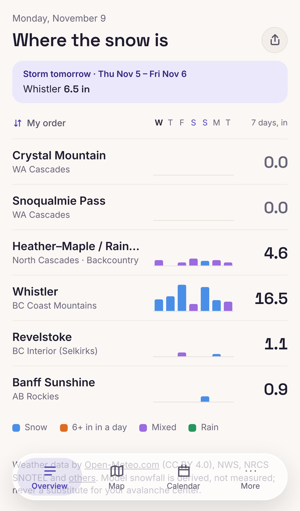
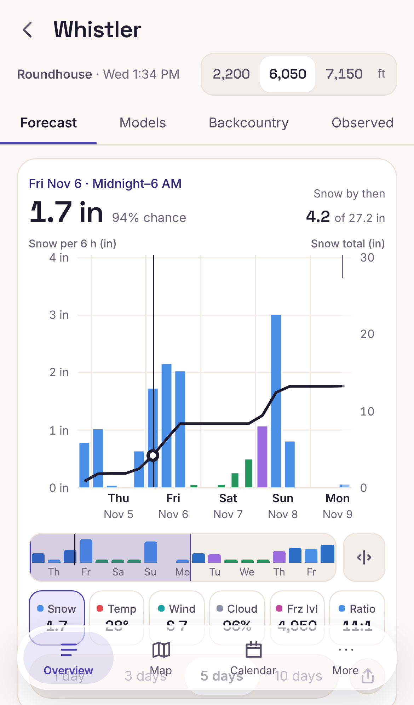
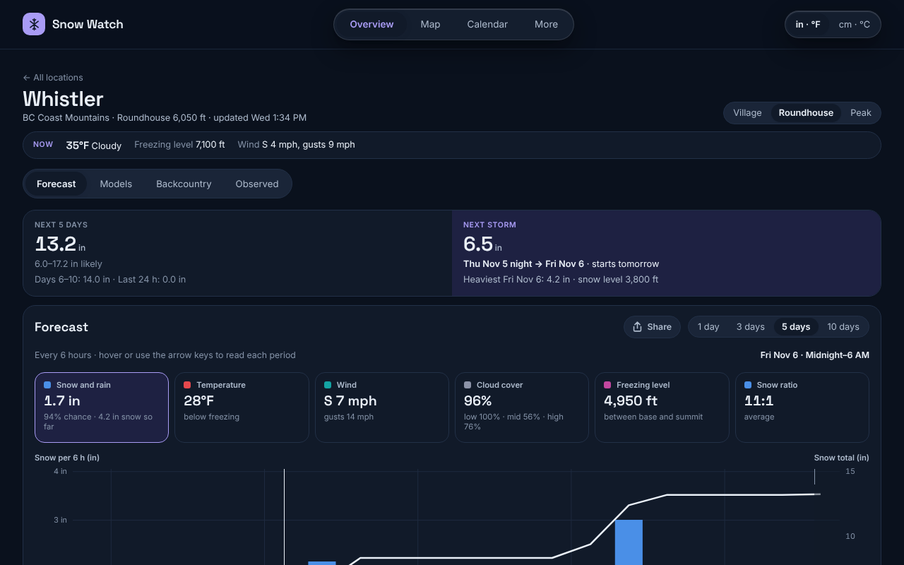
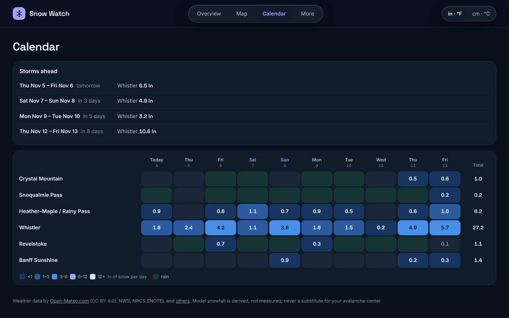

# Snow Watch

Self-hosted snow forecasts for ski resorts and backcountry zones. Snow Watch
compares several weather models side by side and shows a model consensus with
honest uncertainty: what the ensembles allow, where the models disagree, what the
snow stations measured, and the official avalanche rating.

<p>
  
  
</p>


## Features

- **Forecasts at base, mid and summit**: a consensus of GFS, ECMWF, GEM and ICON,
  plus HRRR, NBM and HRDPS for the first 48 h, updated four times a day.
- **Uncertainty you can see**: ensemble ranges, chance-of-snow curves, model
  agreement, outliers flagged, and how the forecast changed over the last runs.
- **Overview, calendar and map**: where and when the snow is, storm cycles, a
  radar and forecast precipitation map with ski runs and 3D terrain.
- **Backcountry**: avalanche danger exactly as published (hidden once expired),
  ridge-height wind and loading, warming, rain on snow, refreeze, daylight.
  Snow Watch never says whether terrain is safe.
- **Resort days**: a Powder / Great / Good / Fair / Poor rating with its reasons.
- **Snow stations**: SNOTEL and BC snow pillows, and a scorecard of how the
  forecast did against them.
- **Works like an app**: installs to the home screen, works offline with the last
  forecast and saved map areas, optional push alerts for powder days and storms.
- **Accessible**: keyboard and screen-reader friendly, light and dark themes,
  imperial or metric units.
- **Simple to run**: two Docker containers and a SQLite file. No accounts, no
  third-party login: one owner password unlocks managing locations.



## Quick start (Docker)

```bash
git clone https://github.com/alaurin10/Snow-Forecast.git && cd Snow-Forecast
```
```bash
cp .env.example .env && mkdir -p data
```

Set `NWS_CONTACT` and `OWNER_PASSWORD` in `.env`, then:

```bash
docker compose up -d --build
```
```bash
docker compose run --rm worker snowwatch init && docker compose run --rm worker snowwatch pull
```

Open http://localhost:8090. For HTTPS, automatic updates, push alerts, backups and
troubleshooting, see [docs/DEPLOYMENT.md](docs/DEPLOYMENT.md).

## Configuration

Everything is set in `.env` ([`.env.example`](.env.example) explains each line):

| Setting | Default | Purpose |
|---|---|---|
| `OWNER_PASSWORD` | empty (Manage off) | Unlocks Manage locations; 12+ characters |
| `NWS_CONTACT` | | Email or URL the US National Weather Service asks for |
| `PUBLIC_URL` | | The site's HTTPS address |
| `TRUSTED_PROXY` | `0` | `1` behind a reverse proxy or Cloudflare |
| `MAX_LOCATIONS` | `25` | Cap on active locations (each uses ~150 Open-Meteo calls a day) |
| `VAPID_PUBLIC_KEY`, `VAPID_PRIVATE_KEY` | empty (alerts off) | Push alerts: `snowwatch push keys` |
| `CONTACT_EMAIL` | `NWS_CONTACT` | Email for push services |
| `HEALTHCHECKS_RUN_URL`, `HEALTHCHECKS_BACKUP_URL` | empty | Optional Healthchecks.io pings |
| `TILES_MAX_MB` | `2000` | Disk cap for the map tile cache |
| `PUSH_MAX_SUBSCRIPTIONS` | `500` | Most devices with alerts on |
| `HAZARD_INDEX` | `owner` | Who sees the map's experimental avalanche concern index: `off`, `owner` (signed in) or `public` |

Forecast models, thresholds and the schedule are in
[`config/forecast.yaml`](config/forecast.yaml); the approximate treeline bands the map's
avalanche layers use are in [`config/treeline.yaml`](config/treeline.yaml); the starting locations are in
[`config/seed-locations.yaml`](config/seed-locations.yaml).

## Development

Needs [uv](https://docs.astral.sh/uv/) and Node.js 24 (it ships npm 11; on Node
22, run `npm install -g npm@11` first).

```bash
cd backend && uv sync && uv run snowwatch init && uv run snowwatch rebuild --from tests/fixtures/live-20261104
```
```bash
cd backend && OWNER_PASSWORD=dev-owner-password uv run uvicorn snowwatch.api.app:app --reload --port 8000
```
```bash
cd frontend && npm install && npm run dev
```

The app is then at http://localhost:5173 (it proxies `/api` to port 8000), with
forecasts rebuilt from saved responses, so no weather API is called. See
[CONTRIBUTING.md](CONTRIBUTING.md) for the checks CI runs and the conventions.

## Command line

Run from `backend/` with `uv run snowwatch …`, or on a server with
`docker compose run --rm worker snowwatch …`:

| Command | What it does |
|---|---|
| `init` | Create or migrate the database and seed the locations |
| `pull [--only ID …] [--ensembles]` | Fetch, analyse and store forecasts now |
| `show ID [--band base\|mid\|summit]` | Print a location's latest forecast as a table |
| `worker [--run-now]` | The scheduler (what the worker container runs) |
| `rebuild [--from FOLDER]` | Rebuild forecasts from cached or saved responses, with no API calls |
| `backup` | Write a database backup and a `locations.yaml` copy now |
| `locations list\|import\|export\|stations`, `budget` | Manage the list from the terminal; estimated Open-Meteo use |
| `avalanche refresh`, `lookups refresh`, `precip`, `ski-map` | Refresh one kind of data now |
| `map radar\|forecast\|totals\|all` | Redraw one part of the map's pictures now (`precip` is `map all`) |
| `owner logout-all` | End every owner session (after changing the password) |
| `push keys` | Print a new key pair for push alerts |
| `healthcheck worker` | Exit 0 if the worker is alive (its Docker health check) |
| `check-sources --write ../docs/SOURCES.md` | Probe every upstream source and write a report |
| `schema --out FILE` | Write the API's JSON Schema (source of the frontend types) |
| `capture-fixtures` | Save today's real responses as test fixtures |

## Documentation

- [docs/DEPLOYMENT.md](docs/DEPLOYMENT.md): running it, updates, backups, troubleshooting.
- [docs/ARCHITECTURE.md](docs/ARCHITECTURE.md): how it works, the analysis, the security model.
- [docs/SOURCES.md](docs/SOURCES.md): the latest check of every data source.
- [docs/deploy-notes-home.md](docs/deploy-notes-home.md): one real installation, as an example.
- [CHANGELOG.md](CHANGELOG.md), [SECURITY.md](SECURITY.md), [CONTRIBUTING.md](CONTRIBUTING.md).

## Data and licences

Snow Watch's code is under the [MIT licence](LICENSE). The data it shows comes from
Open-Meteo (CC BY 4.0), NOAA/NWS, NRCS SNOTEL, the BC River Forecast Centre (Open
Government Licence – British Columbia), Environment and Climate Change Canada (Open
Government Licence – Canada), RainViewer, avalanche.org,
Avalanche Canada, OpenStreetMap contributors and OpenSkiMap (ODbL), OpenTopoMap
(CC-BY-SA), Esri, and Mapzen terrain tiles on AWS. Each keeps its own terms; see
[THIRD_PARTY_NOTICES.md](THIRD_PARTY_NOTICES.md). Some, such as Open-Meteo's free
API and the Esri and OpenTopoMap tiles, are for non-commercial use.

Forecasts are estimates and can be badly wrong. Snow Watch is not a substitute
for your local avalanche center.
